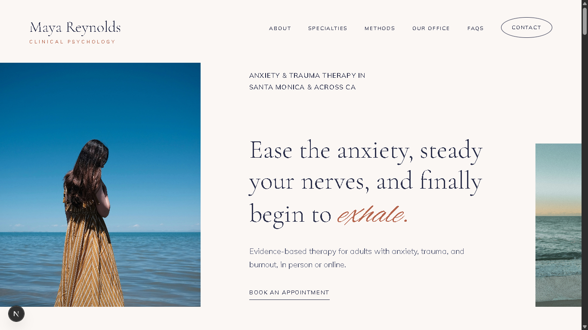
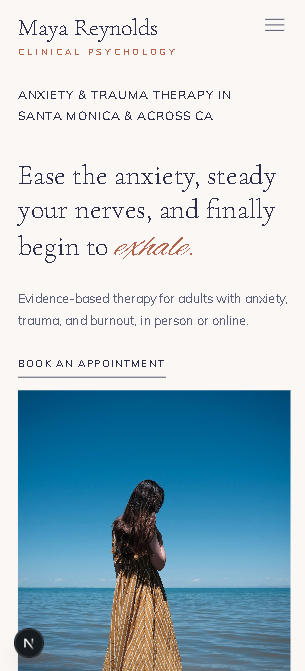

# Dr. Maya Reynolds | Clinical Psychology Practice

A clean and responsive homepage built for Dr. Maya Reynolds, a clinical psychologist based in Santa Monica, CA specializing in anxiety, trauma, and burnout.



## 🔗 Links
- **Live Site:** https://dr-maya-psychology.netlify.app
- **Video Walkthrough:** [Insert Loom Link Here]
- **GitHub:** https://github.com/itsvivekdev/dr-maya-reynolds-therapy

---

## 📌 Project Overview
This project was built as part of the Stage 2 assignment for **Grow My Therapy**. 

The goal was twofold:
1. Recreate the structure, spacing, and mobile responsiveness of the reference template (`conejovalleycounseling.com`).
2. Redesign the site from scratch for Dr. Maya Reynolds, using her provided profile as the single source of truth for the copy, images, and overall vibe.

---

## 🎨 What I Did

- **Color Palette:** Moved away from the original earthy cream/teal theme to a calmer Pacific Coast palette—deep navy for readability, soft mist backgrounds, and subtle lavender/mauve accents.
- **Copywriting & SEO:** Rewrote all headlines and text in Dr. Maya’s voice. Naturally included her core specialties (Anxiety, EMDR, Burnout) and location keywords (*Santa Monica*, *California Telehealth*) without keyword stuffing.
- **New "Our Office" Section:** Added a dedicated office space section (which was not in the original template) using photos and office details from her profile.
- **Layout & Mobile Menu:** Kept the original layout structure intact, ensuring the mobile slide-over drawer and desktop navigation work smoothly.



---

## 🛠 Tech Stack

- **Framework:** Next.js (App Router)
- **Styling:** Tailwind CSS
- **Fonts:** Cormorant Garamond, Mulish, and Alex Brush (via `next/font/google`)
- **Icons:** Lucide React
- **Deployment:** Netlify

---

## 🚀 Running Locally

1. Clone the repo:
   ```bash
   git clone [https://github.com/itsvivekdev/dr-maya-reynolds-therapy.git](https://github.com/itsvivekdev/dr-maya-reynolds-therapy.git)
